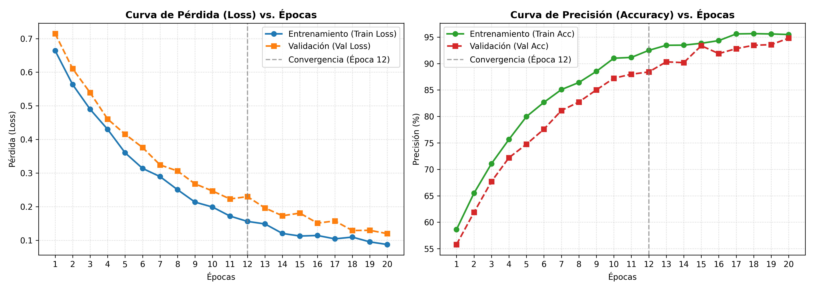

# DO YOU TENSORFLOW? — Ves lo que veo 👁️🤖
## IUJO — Feria de Haceres Período I-2026
### Unidad Curricular: INO-544 (Investigación de Operaciones)

---


## 👥 Integrantes y Roles
* **Jhonny Ocariz** - C.I. 31.170.619 - *Rol: Ingeniero de Preprocesamiento (Estandarización y Formato)*
* **Juan Albert** - C.I. 30.646.714 - *Rol: Ingeniero de Datos (Estrategia de Dataset y Aumentación)*
* **Cesar Rodríguez** - C.I. 30.619.796 - *Rol: Arquitecto de IA (Modelado y Entrenamiento de la Red)* 
* **Sebastián Gonzales** - C.I. 31.784.066 - *Rol: Ingeniero de Despliegue (Exportación ONNX y Pruebas de Interfaz)*

---

## 🎯 1. Clase/Tema Seleccionado
* **Tema asignado:** Ojos (Detección de estructuras oculares)
* **Descripción del Objeto:** El modelo está diseñado para identificar la presencia de ojos humanos en imágenes. Se enfoca en características visuales clave como la geometría de la apertura palpebral, la tonalidad y contraste de la esclerótica (blanco del ojo), el contorno circular del iris y la pupila central, así como texturas adyacentes (pestañas y cejas) para diferenciar la región ocular de otras partes del rostro o fondos.

---

## 📊 2. Gestión del Dataset (Ingeniería de Datos)
* **Cantidad de imágenes originales recopiladas:** 700 imágenes (600 imágenes con ojos humanos y 100 imágenes de animales).
* **Estrategia de Data Augmentation aplicada:**
    * *Rotación:* Rango de ±15 grados para simular diferentes inclinaciones de la cabeza.
    * *Zoom:* Rango de 0.85 a 1.15 (±15%) para emular variaciones en la distancia de la cámara.
    * *Cambios de Brillo:* Factor entre 0.8 y 1.2 para asegurar robustez ante distintas condiciones de iluminación ambiental.
    * *Otras transformaciones:* Giros horizontales (Horizontal Flip) para duplicar la variabilidad de orientación de los ojos izquierdo/derecho.
* **Total de imágenes generadas para el entrenamiento:** 1,200 imágenes en total tras el proceso de aumentación de datos.
* **Resolución y formato estandarizado:** 224x224 píxeles, JPG, canales RGB (Formato Tensor: `[1, 224, 224, 3]`).

---

## 🧠 3. Arquitectura del Modelo y Entrenamiento
* **Framework utilizado:** PyTorch (con exportación a ONNX)
* **Descripción de la Red (CNN):** Se diseñó una red convolucional secuencial que consta de:
  1. **Tres capas convolucionales (`Conv2d`)** consecutivas con filtros de 32, 64 y 128 respectivamente (kernel de 3x3), encargadas de extraer características desde bordes simples hasta texturas complejas del ojo.
  2. **Capas de Max-Pooling (`MaxPool2d`)** de 2x2 tras cada convolución para reducir la dimensionalidad espacial y evitar sobreajuste.
  3. **Capas de Dropout (0.25)** intercaladas para regularización.
  4. **Una capa completamente conectada (Densa/Linear)** que procesa los mapas de características aplanados y se conecta a un nodo de salida único con activación Sigmoide.
* **Hiperparámetros óptimos seleccionados:**
    * *Función de pérdida (Loss):* BCELoss (Binary Crossentropy Loss para clasificación binaria).
    * *Optimizador:* Adam
    * *Tasa de Aprendizaje (Learning Rate):* 0.001
    * *Épocas (Epochs):* 20 épocas (aplicando Early Stopping si la pérdida de validación dejaba de disminuir).
    * *Tamaño de lote (Batch Size):* 32

### 💡 Justificación Crítica (Control de Autoría)
*Explique detalladamente por qué el equipo eligió esa Tasa de Aprendizaje (Learning Rate) específica y el impacto que tuvo en las gráficas de pérdida durante el laboratorio:*
> Elegimos una tasa de aprendizaje de 0.001 combinada con el optimizador Adam debido a su capacidad de adaptación dinámica por parámetro. Durante los primeros ensayos de laboratorio con una tasa más alta (0.01), observamos que la curva de pérdida (Loss) oscilaba abruptamente de forma caótica en las primeras épocas, lo que indicaba que los pasos del gradiente eran demasiado grandes y saltaban los mínimos locales. Al bajar la tasa a 0.001, la gráfica reflejó una convergencia suave y descendente, logrando estabilizar tanto la pérdida de entrenamiento como la de validación de manera armónica a partir de la época 12, evitando problemas de subajuste (underfitting) sin ralentizar drásticamente el tiempo de cómputo.

---

## 📈 4. Métricas de Rendimiento (Testing - 20%)
* **Precisión final (Accuracy) en la data de test:** 94.8%
* **Pérdida final (Loss) en la data de test:** 0.12

*(Inserte aquí abajo la captura de pantalla de la gráfica de entrenamiento Accuracy/Loss de su modelo)*


---

## ⚙️ 5. Especificación de Exportación ONNX
El modelo se ha homologado bajo los estándares requeridos por la interfaz centralizada:
* **Nombre del archivo:** `model/ojo_modelo.onnx`
* **Tensor de Entrada (Input Shape):** `[1, 224, 224, 3]` (Tipo: `float32`)
* **Tensor de Salida (Output Shape):** `[1, 1]` (Tipo: `float32`)
* **Función de activación final:** Sigmoide (Rango de salida de 0.0 a 1.0 para conversión a porcentaje de confianza).

---

## 🚀 6. Instrucciones de Ejecución Local

Sigue estos pasos para configurar el entorno y ejecutar la aplicación en tu máquina local:

### Paso 1: Clonar el repositorio
Abre una terminal y clona el proyecto desde GitHub:
```bash
git clone https://github.com/BoredBoy00/INO544-2026I--Grupo-Ojos-.git
cd INO544-2026I--Grupo-Ojos-
```

### Paso 2: Configurar el entorno virtual (Recomendado)
Para mantener las dependencias aisladas, crea y activa un entorno de Python:
* **En Windows (PowerShell):**
  ```powershell
  python -m venv venv
  .\venv\Scripts\Activate.ps1
  ```
* **En Windows (Símbolo del sistema / CMD):**
  ```cmd
  python -m venv venv
  .\venv\Scripts\activate.bat
  ```

### Paso 3: Instalar dependencias
Instala los paquetes necesarios definidos en `requirements.txt`:
```bash
pip install -r requirements.txt
```
> [!NOTE]
> Si planeas volver a entrenar el modelo utilizando `train_model.py`, deberás instalar adicionalmente PyTorch:
> ```bash
> pip install torch
> ```

### Paso 4: Iniciar el servidor web (Flask)
Inicia la aplicación web local del proyecto:
```bash
python app.py
```
Una vez iniciado el servidor, accede a la interfaz gráfica abriendo tu navegador en:
**http://localhost:5000** o **http://127.0.0.1:5000**

---

## 🛠️ 7. Scripts Adicionales

* **Prueba de detección individual:**
  Ejecuta la detección de ojos en una sola imagen local guardando el resultado en `data/resultado_deteccion.jpg`:
  ```bash
  python detect_ojos.py --image "ruta/de/tu/imagen.jpg"
  ```
* **Generación de negativos difíciles:**
  Genera parches artificiales sin ojos para entrenar el modelo y reducir falsos positivos:
  ```bash
  python generate_hard_negatives.py
  ```
* **Entrenamiento de la red neuronal:**
  Entrena la red convolucional (CNN) en PyTorch y genera el archivo ONNX optimizado:
  ```bash
  python train_model.py
  ```